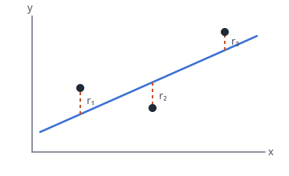

## The model

We predict a target $y$ from one feature $x$ with a straight line

$$\hat y = w_0 + w_1 x .$$

The two numbers $w_0$ (intercept) and $w_1$ (slope) are the **parameters**. Fitting means
choosing them from $n$ observed pairs $(x_1, y_1), \dots, (x_n, y_n)$.

:::definition Residual
The residual of point $i$ is $r_i = y_i - \hat y_i$: how far the line is from that point,
measured vertically.
:::

{.adapt}

## The loss

Least squares picks the line whose residuals are smallest in total, after squaring:

$$L(w) = \sum_{i=1}^{n} (y_i - w_0 - w_1 x_i)^2 = \lVert y - Xw \rVert^2 .$$

Here $w = (w_0, w_1)^\top$, $y$ stacks the targets, and $X$ is the $n \times 2$ **design
matrix** whose $i$-th row is $(1, x_i)$. The matrix form is the one to remember: it stays
the same when there are more features (lecture slide 9).

:::note Why squares and not absolute values?
Squaring makes $L$ smooth, so it has a gradient everywhere, and it makes the minimiser
available in closed form. The price is sensitivity to outliers: one far point is squared too.
:::

## The normal equations

:::theorem
If the columns of $X$ are linearly independent, $L$ has the unique minimiser

$$w^\star = (X^\top X)^{-1} X^\top y .$$
:::

:::proof
Expand $L(w) = (y - Xw)^\top (y - Xw)$ and differentiate:

$$\nabla L(w) = -2 X^\top (y - Xw) .$$

At a minimum the gradient is zero, so $X^\top X\, w = X^\top y$. Independent columns make
$X^\top X$ positive definite, hence invertible, and also make $L$ strictly convex, so this
stationary point is the one global minimum.
:::

:::paper
Normal equations: $X^\top X\, w = X^\top y$. Solve this $2 \times 2$ system; do not invert.
:::

## Worked example

| $x$ | $y$ |
|-----|-----|
| 0   | 1   |
| 1   | 3   |
| 2   | 5   |

The design matrix has rows $(1,0)$, $(1,1)$, $(1,2)$, so

$$X^\top X = \begin{pmatrix} 3 & 3 \\ 3 & 5 \end{pmatrix}, \qquad X^\top y = \begin{pmatrix} 9 \\ 13 \end{pmatrix}.$$

Subtracting the first equation $3w_0 + 3w_1 = 9$ from the second $3w_0 + 5w_1 = 13$ gives
$2w_1 = 4$, so $w_1 = 2$ and $w_0 = 1$. The fitted line is $\hat y = 1 + 2x$, and because
the three points lie exactly on it every residual is zero.

In code the same fit is one call:

```python
import numpy as np

X = np.array([[1, 0], [1, 1], [1, 2]], dtype=float)
y = np.array([1, 3, 5], dtype=float)
w, *_ = np.linalg.lstsq(X, y, rcond=None)   # array([1., 2.])
```

:::pitfall
Do not compute `np.linalg.inv(X.T @ X)`. Forming the inverse squares the condition number
and loses precision; `lstsq` solves the same problem stably.
:::

:::recall When is the least-squares solution not unique?
When the columns of $X$ are linearly dependent: a duplicated feature, a constant feature
next to the intercept, or fewer data points than parameters. Then $X^\top X$ is singular.
:::

## Where next

[](lecture:02-gradient-descent) reaches the same minimum by iterating, which is what you do
when $X$ is too large to factorise. Drill this lecture with [the deck](deck:least-squares),
then try [the first practice problem](problems:fitting-practice#fit-p1). The formula is on
the sheet as [](formula:f-normal).
